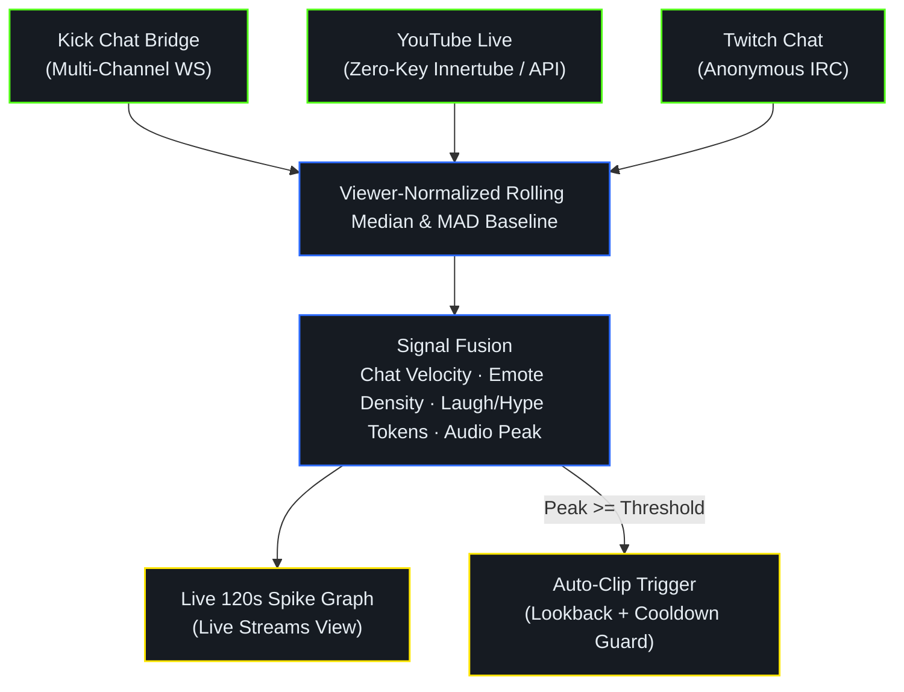

<div align="center">

<a id="readme-top"></a>


<h1>PulseCut</h1>

<p>
  <strong>100% Local-First Livestream &amp; VOD Clipping Engine · Two-Stage Framing &amp; Shorts Studio · Autonomous Publishing</strong>
</p>

<p>
  Turn Kick, YouTube Live, Twitch streams &amp; long-form VODs into frame-accurate, karaoke-captioned, QA-verified viral shorts — right on your own machine with zero cloud lock-in.
</p>

<p>
  
  
  
  
  <a href="LICENSE"></a>
</p>

<p>
  <a href="#-how-it-works">Pipeline</a> &nbsp;·&nbsp;
  <a href="#-feature-overview">Features</a> &nbsp;·&nbsp;
  <a href="#-interactive-studio-tour">Studio Tour</a> &nbsp;·&nbsp;
  <a href="#-live-streams--spike-engine">Live Monitor</a> &nbsp;·&nbsp;
  <a href="#-quick-start">Quick Start</a> &nbsp;·&nbsp;
  <a href="#-publishing--qa-gates">Publishing</a> &nbsp;·&nbsp;
  <a href="#-workspace--docs">Architecture</a>
</p>

</div>

---

> [!TIP]
> **Zero subscriptions. Zero watermarks. Zero forced uploads.**
> PulseCut runs a fast **Rust engine** (`127.0.0.1:8756`) alongside **PulseCut Studio** (`127.0.0.1:3000`), keeping your raw streams, Whisper transcripts, custom fonts, templates, and rendered shorts 100% local until you explicitly approve them to publish.

---

<a id="-how-it-works"></a>
## ⚡ How It Works

Every livestream spike or VOD link flows through a deterministic, inspectable local pipeline — from raw ingest to a 100-point QA-scored short:

```mermaid
flowchart LR
    classDef ingest fill:#161b22,stroke:#53FC18,stroke-width:2px,color:#e6edf3
    classDef engine fill:#161b22,stroke:#2D6BFF,stroke-width:2px,color:#e6edf3
    classDef studio fill:#1b1f2a,stroke:#a371f7,stroke-width:2px,color:#e6edf3
    classDef gate fill:#161b22,stroke:#FFE600,stroke-width:2px,color:#e6edf3
    classDef publish fill:#161b22,stroke:#FF0033,stroke-width:2px,color:#e6edf3

    A["📡 Live Streams & VODs<br/>Kick · YouTube · Twitch · Local MP4"]:::ingest
    B["📈 Adaptive Spike Engine<br/>Rolling Median/MAD · Viewer Baseline"]:::engine
    C["🧠 Local AI Pipeline<br/>faster-whisper · Viral Ranker"]:::engine
    D["🖼️ Framing Studio<br/>6 Layouts · Full-Res Source Crops"]:::studio
    E["🎬 Shorts Studio<br/>12 Templates · Karaoke · SFX & Riser"]:::studio
    F["✅ 100-Pt Vitality QA<br/>3 Sample Frames · Approval Gate"]:::gate
    G["🚀 3-Tier Publisher<br/>YT Shorts · Reels · TikTok · 9+"]:::publish

    A --> B
    A --> C
    B -->|Auto-Clip on Peak| C
    C -->|Word-Snapped Moments| D
    D -->|Blueprint Handoff| E
    E -->|FFmpeg CRF 16| F
    F -->|Explicit Approve| G
```



---

<a id="-feature-overview"></a>
## 🎛️ Feature Overview

<table>
  <tr>
    <td width="50%" valign="top">
      <h3>📡 Direct-Link Multi-Stream Monitor</h3>
      Watch multiple <strong>Kick</strong>, <strong>YouTube Live</strong>, and <strong>Twitch</strong> channels simultaneously right inside the <strong>Live Streams</strong> view — no fragile browser tabs required.
      <ul>
        <li>Live 120-second interactive chat-hype &amp; spike graphs per stream</li>
        <li>Adaptive <strong>rolling median / MAD</strong> + viewer-count-aware baseline</li>
        <li>Per-stream sensitivity, lookback window, cooldown &amp; auto-clip toggle</li>
        <li>Optional Chrome extension for 1-click manual <em>"Clip Last 30s"</em></li>
      </ul>
    </td>
    <td width="50%" valign="top">
      <h3>🧠 Full-Video AI &amp; Viral Discovery</h3>
      Downloads the highest available source quality via <code>yt-dlp</code>, transcribes the entire video locally with word timestamps, and isolates peak shareable moments.
      <ul>
        <li>Local <code>faster-whisper</code> / <code>whisper.cpp</code> (Groq, OpenAI &amp; VTT fallbacks)</li>
        <li>Multi-factor scoring: <strong>Hook · Emotion · Value · Shareability · Audio</strong></li>
        <li>Boundary snapping to clean word &amp; sentence transitions</li>
        <li>Auto-generated titles, hooks, descriptions &amp; niche trending hashtags</li>
      </ul>
    </td>
  </tr>
  <tr>
    <td width="50%" valign="top">
      <h3>🖼️ Stage 1 — Framing Studio</h3>
      Frame directly on the full pre-crop <code>1920×1080</code> source canvas with real-time 2D compositor parity before rendering.
      <ul>
        <li><strong>6 Layouts:</strong> Solo, Split, Trio, PiP Facecam, Centered &amp; 16:9 Clip</li>
        <li><strong>Full Screen (100%)</strong> mode + rectangular/rounded/circle PiP facecams</li>
        <li>Independent draggable aspect-locked crop boxes &amp; slot swapping</li>
        <li>Blur, Color, Gradient, Image backdrops, corner radius &amp; playback speed</li>
      </ul>
    </td>
    <td width="50%" valign="top">
      <h3>🎬 Stage 2 — Shorts Studio</h3>
      Polish, stitch, caption, and export production-ready <code>1080×1920</code> H.264 shorts with zero clipping or safe-zone overlap.
      <ul>
        <li>Multi-segment highlight stitching on a visual track timeline</li>
        <li><strong>12 Viral Templates</strong> + create, customize &amp; delete your own</li>
        <li><strong>12 Karaoke Caption Styles</strong> + 23 fonts + custom <code>.ttf/.otf</code> upload</li>
        <li>Copyright-free music catalog, ducking/riser curve, built-in SFX &amp; outros</li>
      </ul>
    </td>
  </tr>
  <tr>
    <td width="50%" valign="top">
      <h3>✅ 100-Point Vitality QA Rubric</h3>
      Every exported clip can be automatically audited before it ever touches a social account.
      <ul>
        <li>Validates resolution, FPS, loudness (LUFS), duration &amp; aspect ratio</li>
        <li>Checks <code>fit_font_size()</code> title safety &amp; 2026 platform safe zones</li>
        <li>Extracts 3 QA frames (start / hook / climax) for instant visual review</li>
        <li>Hard approval gate: <code>verify → caption → approve → publish</code></li>
      </ul>
    </td>
    <td width="50%" valign="top">
      <h3>🚀 3-Tier Publishing &amp; Automation</h3>
      Run manually in PulseCut Studio or wire up fully autonomous clipping pipelines with the CLI agent.
      <ul>
        <li><strong>Tier 1:</strong> One key → 9–22+ platforms (WoopSocial, Upload-Post)</li>
        <li><strong>Tier 2:</strong> Self-hosted schedulers (Postiz, Mixpost)</li>
        <li><strong>Tier 3:</strong> Direct YouTube Shorts, TikTok &amp; Instagram Reels APIs</li>
        <li>Duplicate-publish prevention + Rust &amp; Python automation CLI</li>
      </ul>
    </td>
  </tr>
</table>

---

<a id="-interactive-studio-tour"></a>
## 🎨 Interactive Studio Tour

Click any drawer below to explore layouts, templates, caption styles, and audio tools.

<details open>
<summary><strong>🖼️ Explore the 6 Framing Studio Layouts (Visual Wireframes)</strong></summary>
<br/>

```text
  [ Solo 9:16 ]      [ Split Cam ]       [ Trio Stack ]     [ Reaction PiP ]    [ Centered / Blur ]  [ 16:9 Clip ]
 ┌─────────────┐    ┌─────────────┐     ┌─────────────┐    ┌─────────────┐     ┌─────────────┐      ┌───────────────┐
 │             │    │   Facecam   │     │   Slot 1    │    │ ┌───────┐   │     │ ░░░░░░░░░░░ │      │               │
 │  Full-Res   │    │  (Top Crop) │     ├─────────────┤    │ │ Face  │   │     │ ┌─────────┐ │      │  Full 16:9    │
 │  Primary    │    ├─────────────┤     │   Slot 2    │    │ └───────┘   │     │ │  16:9   │ │      │  Widescreen   │
 │  Subject    │    │  Gameplay   │     ├─────────────┤    │  Gameplay   │     │ │  Video  │ │      │  Highlight    │
 │  or 100% FS │    │  (Bottom)   │     │   Slot 3    │    │   Canvas    │     │ └─────────┘ │      │               │
 └─────────────┘    └─────────────┘     └─────────────┘    └─────────────┘     │ ░░░░░░░░░░░ │      └───────────────┘
                                                                               └─────────────┘
```

- **Full Screen 100% Mode**: Toggle instant full-frame capture without forcing a narrow vertical slice.
- **Flexible PiP Facecam**: Choose `16:9`, `4:3`, `Free Rect`, or `1:1` shapes with adjustable corner radius and custom placement.
- **Custom Slot Sources**: Swap any crop slot with external B-roll video or a static image overlay.

</details>

<details>
<summary><strong>🎬 Explore Built-In Templates, Karaoke Captions &amp; Audio Engine</strong></summary>
<br/>

| Category | Built-In Presets | Highlights |
| :--- | :--- | :--- |
| **Viral Hooks** | `Classic Short` *(default)* · `Story Hook` | Clean auto-fitted white headline + punchy Hormozi yellow subtitles |
| **Platform Native** | `Kick Viral` · `YT Shorts` · `Insta Reels` | Official **Kick Green (`#53FC18`)** `K` badge, YT/IG attribution &amp; 2026 safe zones |
| **Streamer &amp; Reactions** | `Split Cam` · `Reaction PiP` | Pre-wired dual-source facecam + gameplay framing &amp; lower-third captions |
| **Podcasts &amp; Social** | `Podcast Cut` · `X / Tweet Card` | Clean speaker framing, tweet-style header card &amp; centered karaoke captions |
| **Custom Templates** | *Create / Edit / Delete in-app* | Save your own aspect ratio, caption anchor, font, logo, colors &amp; safe zones |

**Typography, Captions &amp; Audio Polish:**
- **12 Word-Synced Caption Styles**: Karaoke pop, highlight box, neon glow, bold outline, minimal clean, typewriter, and more — rendered from exact word timestamps.
- **23 Viral Fonts + Custom Upload**: Drop any `.ttf` or `.otf` right into Studio.
- **Audio &amp; Music Suite**: Categorized copyright-free music catalog (sad, happy, thrilled, viral/trending), automatic voice-aware **music ducking + end riser**, and one-click **SFX cues** (`whoosh`, `pop`, `vine boom`, `cash`, `riser`).
- **Auto-Fit Text Safety**: `fit_font_size()` dynamically scales long hook headlines and outro cards so text never clips off the canvas edges.

</details>

---

<a id="-live-streams--spike-engine"></a>
## 📡 Live Streams &amp; Adaptive Spike Engine

PulseCut monitors live chat directly at the source, learning each stream's unique baseline instead of relying on brittle hard-coded thresholds.



<details>
<summary><strong>🔎 Compare: Direct-Link Headless Monitor vs. Chrome Extension</strong></summary>
<br/>

| Capability | Direct-Link Live Monitor *(Recommended)* | Chrome Extension (`tools/extension/`) |
| :--- | :---: | :---: |
| **Multi-stream headless monitoring** | ✅ Unlimited concurrent channels | ⚠️ Requires open browser tab per stream |
| **Live 120s adaptive spike graphs** | ✅ Continuous msg/s &amp; hype telemetry | ❌ Trigger-only (no continuous graph) |
| **Viewer-aware learned baseline** | ✅ Real-time rolling median + MAD | ⚠️ Page-local heuristic |
| **1-click manual "Clip Last 30s" while watching** | ✅ Via Studio UI | ✅ Best-in-class in-page HUD &amp; popup |
| **Immune to DOM changes / tab sleep** | ✅ Direct protocol feed | ❌ Depends on active page DOM |

> Read the full math &amp; tuning reference in [`docs/SPIKE_DETECTION.md`](docs/SPIKE_DETECTION.md).

</details>

---

<a id="-quick-start"></a>
## ⚡ Quick Start

### Prerequisites
- **[Rust](https://rustup.rs/)** (1.80+) · **[Node.js](https://nodejs.org/)** (20+) · **[FFmpeg](https://ffmpeg.org/)** &amp; **[yt-dlp](https://github.com/yt-dlp/yt-dlp)** in `PATH`
- *(Optional)* **Python 3.10+** for `faster-whisper` local transcription, Kick chat bridge, and automation helpers

<details open>
<summary><strong>🪟 Option A — One-Click Local Launch (Windows PowerShell)</strong></summary>
<br/>

Starts the Rust Engine (`127.0.0.1:8756`) and PulseCut Studio (`127.0.0.1:3000`) with local Whisper wired automatically:

```powershell
.\scripts\START-LOCAL.ps1
```

Then open **PulseCut Studio** at [`http://127.0.0.1:3000`](http://127.0.0.1:3000) *(and check Engine Status/API at [`http://127.0.0.1:8756`](http://127.0.0.1:8756))*.

</details>

<details>
<summary><strong>💻 Option B — Manual Dev Launch (macOS / Linux / Windows)</strong></summary>
<br/>

**Terminal 1 — Rust Engine API &amp; Renderer (`:8756`):**
```bash
cargo run --release -p pulsecut -- editor --addr 127.0.0.1:8756
```

**Terminal 2 — PulseCut Studio Frontend (`:3000`):**
```bash
npm install
npm run dev
```

Need a step-by-step walkthrough with FFmpeg, Whisper, and `yt-dlp` setup? See [`QUICKSTART.md`](QUICKSTART.md).

</details>

<details>
<summary><strong>🟢 Option C — Enable Direct-Link Kick Live Chat Bridge</strong></summary>
<br/>

Kick protects its Pusher WebSocket behind Cloudflare; the bundled local Python bridge streams live chat from multiple Kick channels simultaneously into the Rust engine:

```bash
# If Kick rotates its Pusher key, pass the current key once via env var:
export KICK_PUSHER_KEY="<current-pusher-key>"
python tools/kick-chat-bridge/bridge.py
```

Add any number of `kick.com/<channel>`, `youtube.com/@<channel>/live`, or `twitch.tv/<channel>` links inside the **Live Streams** tab to view live spike graphs and enable auto-clipping.

</details>

<details>
<summary><strong>🤖 Option D — Headless Automation Agent &amp; Verification Suite</strong></summary>
<br/>

Drive the entire ingest → transcribe → render → verify → approve → publish workflow from the terminal or an agentic runner:

```bash
# Run system & dependency health check
cargo run -p pulsecut-agent -- doctor

# Inspect, verify & check approval gates via Python controller
python automation/agent.py doctor
```

**Run the full test suite:**
```bash
cargo test --workspace            # Rust engine, detector, renderer & verifier tests
npm test                          # Frontend Studio unit tests
python automation/test_automation.py  # Automation pipeline tests
```

See [`automation/AGENT_PLAYBOOK.md`](automation/AGENT_PLAYBOOK.md) for the complete automation runbook.

</details>

---

<a id="-publishing--qa-gates"></a>
## 🚀 Publishing &amp; QA Safety Gates

> [!IMPORTANT]
> **Built-In Publishing Safety Lock**
> Clips can never be accidentally spammed to live social accounts. Every publish call passes through an explicit state machine:
> `rendered` ➔ `verified (100-pt rubric)` ➔ `captioned` ➔ `approved` ➔ `published` *(with duplicate-publish protection)*.

<details>
<summary><strong>🌐 Compare the 3 Publishing Tiers &amp; Environment Variables</strong></summary>
<br/>

| Tier | Providers | Best For | Key Env Vars |
| :--- | :--- | :--- | :--- |
| **Tier 1 · Unified Aggregators** | **WoopSocial** (9 platforms) · **Upload-Post** (22+ platforms) | One API key to post to YT Shorts, Reels, TikTok, X &amp; more | `PULSECUT_PUBLISHER=woopsocial`<br/>`PULSECUT_WOOPSOCIAL_TOKEN` |
| **Tier 2 · Self-Hosted Schedulers** | **Postiz** · **Mixpost** | Full self-hosted content calendar &amp; team approvals | `PULSECUT_POSTIZ_URL`<br/>`PULSECUT_POSTIZ_KEY` |
| **Tier 3 · Direct Platform APIs** | **YouTube Data API v3** · **TikTok Content Posting** · **Instagram Graph API** | Zero middleman, direct OAuth token ownership | `PULSECUT_YOUTUBE_TOKEN`<br/>`PULSECUT_TIKTOK_TOKEN`<br/>`PULSECUT_IG_TOKEN` |

*Secrets are always read from `PULSECUT_*` environment variables — never committed to [`pulsecut.json`](pulsecut.json).*
- Token acquisition guide: [`automation/TOKENS.md`](automation/TOKENS.md)
- Detailed publishing &amp; OAuth reference: [`docs/PUBLISHING.md`](docs/PUBLISHING.md)

</details>

---

<a id="-workspace--docs"></a>
## 🗂️ Workspace &amp; Documentation

<details>
<summary><strong>📦 Explore the 11-Crate Rust Engine &amp; Frontend Architecture</strong></summary>
<br/>

| Path | Role |
| :--- | :--- |
| [`src/`](src/) | **PulseCut Studio** — React 19 + TypeScript + Vite SPA (Library, Live Streams + Spike Graphs, Framing Studio, Shorts Studio, Templates &amp; Settings) |
| `crates/app` | CLI entry point, lightweight Engine Status page &amp; Axum REST API (`:8756`) |
| `crates/core` | Shared domain models, `pulsecut.json` config loader &amp; job state |
| `crates/chat` | Live chat ingest connectors (Kick bridge client, YouTube Live Innertube/API, Twitch IRC) |
| `crates/detect` | Adaptive rolling median/MAD baseline, viewer normalization &amp; multi-signal spike fusion |
| `crates/capture` | Highest-quality `yt-dlp` VOD fetcher &amp; live rolling stream capture |
| `crates/ai` | Local Whisper word-level transcription, viral moment scorer &amp; LLM metadata/hashtag generation |
| `crates/render` | FFmpeg `CRF 16` compositor, framing layouts, karaoke ASS/drawtext renderer, SFX &amp; music ducking |
| `crates/editor` | Clip blueprint persistence, framing/shorts state sync &amp; studio asset management |
| `crates/verify` | 100-point vitality QA rubric, safe-zone validator &amp; 3-frame QA extractor |
| `crates/publish` | 3-tier publisher adapters (WoopSocial, Upload-Post, Postiz, YouTube, TikTok, Instagram) |
| `crates/agent` | Headless Rust automation CLI (`pulsecut-agent`) |
| [`tools/kick-chat-bridge/`](tools/kick-chat-bridge/) | Multi-channel Kick Pusher WebSocket bridge |
| [`tools/extension/`](tools/extension/) | Chrome / Chromium MV3 extension for manual 1-click clipping |
| [`automation/`](automation/) | Python orchestration controller, `faster-whisper` wrapper, QA verifier &amp; playbook |

</details>

### 📚 Documentation Hub

| Guide | What's Inside |
| :--- | :--- |
| 🚀 [**Quick Start Guide**](QUICKSTART.md) | Step-by-step installation of Rust, FFmpeg, `yt-dlp`, and local Whisper |
| 🏗️ [**System Architecture**](docs/ARCHITECTURE.md) | Crate boundaries, data flow, REST API contracts, and rendering parity |
| 📈 [**Spike Detection Engine**](docs/SPIKE_DETECTION.md) | Rolling median/MAD math, viewer normalization, and signal fusion tuning |
| 🌐 [**Publishing &amp; OAuth Guide**](docs/PUBLISHING.md) | Wiring WoopSocial, Upload-Post, Postiz, YouTube Shorts, TikTok &amp; IG Reels |
| 🔑 [**API Tokens &amp; Keys**](automation/TOKENS.md) | Where to obtain free/local keys for publishers and optional Ollama/OpenRouter |
| 🤖 [**Automation Agent Playbook**](automation/AGENT_PLAYBOOK.md) | End-to-end headless CLI commands, verification gates, and audit workflows |

---

<div align="center">

<p>
  Licensed under <a href="LICENSE"><strong>AGPL-3.0-or-later</strong></a> &nbsp;·&nbsp; Built for creators who own their workflow.
</p>

<p>
  <a href="#readme-top">⬆️ Back to Top</a>
</p>

</div>
